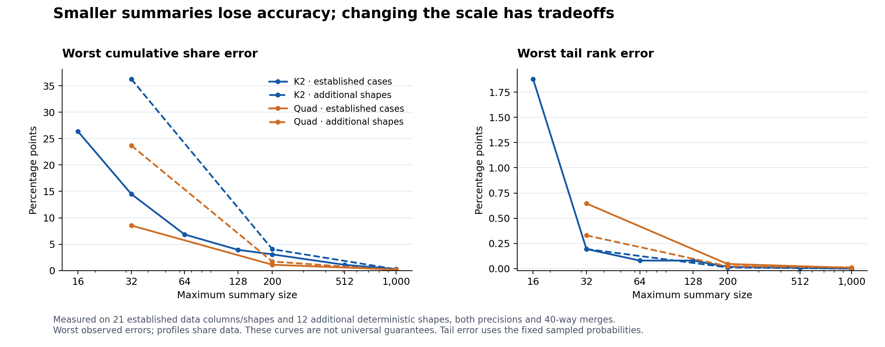
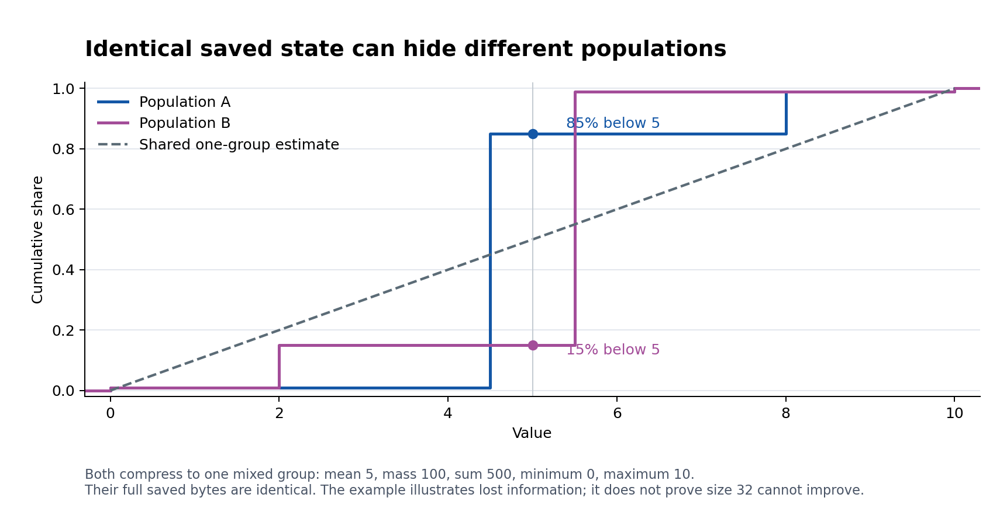

# The accuracy story and recommendation

## Recommendation

Keep the existing K2 scale and the approved default capacity 1,000. Do not adopt
any of the tested compression replacements. They solve selected cases by making
other cases worse. Do not merge or release on the claim that all accuracy work
is finished: the small-summary failures remain numerical acceptance issues.

The modern candidate has real correctness improvements, including all 15 exact
boundary controls passing their unchanged targets. The original engine and its
fixtures remain unchanged. That is separate from claiming that every approximate
answer is sufficiently accurate or better than the original.

## What the investigation establishes

The ten frozen-suite failures were not removed safely. Three new compressor
trials were built and measured over the full 756 profiles. Their source patches,
loaded-native hashes and complete measurements are retained. The unmodified
control has no new per-metric regressions and reproduces the ten known failures.

| Compression approach | Failed accuracy profiles in the frozen corpus | Profiles regressing against the frozen metrics | Decision |
|---|---:|---:|---|
| Current K2 control | 10 | 0 | Retain; limits remain open |
| Cap directly from the original sorted stream | 8 | 263 | Reject |
| Equal-mass allocation | 16 | 480 | Reject |
| Scan in reverse | 12 | 319 | Reject |
| Earlier median-partition trial | 0 | 290 | Previously rejected; separate earlier evidence |

The wider diagnostic adds 4,140 profiles: 3,276 capacity/scale cases over the established
21 data columns/distributions, plus 864 cases over 12 additional deterministic shapes.
It has no construction/state/query exceptions but 114 failed rank/CDF profiles.
Those failures remain explicit and the runner exits nonzero. The old 756-profile
reference and ten-case inventory were not edited. A second execution reproduced
all 4,140 modern scores and the available original scores exactly; it is a repeat,
not 4,140 more independent experiments.

## Summary size matters

These are the worst observed cumulative-share errors, in **percentage points**.
For example, 3 points can mean reporting 53% when the observed share is 50%. The two
columns use different sets of shapes and must not be treated as a statistical
confidence interval.

| K2 capacity | Established data/shapes | Additional shapes |
|---:|---:|---:|
| 16 | 26.383 | not measured |
| 32 | 14.517 | 36.306 |
| 64 | 6.841 | not measured |
| 128 | 3.932 | not measured |
| 200 | 3.069 | 4.050 |
| 512 | 1.087 | not measured |
| 1,000 | 0.278 | 0.240 |



Capacity 64 also exposes eight failed established profiles; “only the ten capacity 32
cases fail” is too narrow once the wider data is considered. On the measured
capacity 200 and 1,000 profiles, all rank/CDF errors stay within the reused 0.05 diagnostic
envelope. This is evidence for those data/merge paths, not an approved universal
error guarantee or permission to exclude smaller capacities.

Larger summaries cost storage. Across matched established profiles, increasing
200 to 1,000 raises saved-state bytes by a median of about 1.43 times, with worst cases
near 4.95 times. Some exact/tied populations do not grow. These are actual saved-byte
ratios, not process memory or temporary-allocation measurements. Production input
mix and memory budgets still matter.

## Why a simple query patch is insufficient

Repeated merging leaves large mixed central groups in small K2 summaries. For the
traced size 32 cases, one mixed group carries about 20–21% of all mass. At 1,000, the
largest mixed groups in those traces carry about 0.39%. Means, weights and overall
extrema do not retain the layout of values inside each mixed group.

The Rust demonstration constructs two exactly representable populations with the
same complete one-group saved state: mean 5, mass 100, sum 500, min 0 and max 10. One has
85% of its mass below 5, the other 15%; the shared estimate is 50%. Their saved bytes
are identical in both precisions. A query cannot recover which population was
compressed. This demonstrates lost information; it does **not** prove that a
better capacity 32 compressor is impossible. Python training requires capacity>=10;
the example deliberately uses the modern Rust capacity 1 API.



The existing Quad setting initially looks promising: it passes all established
capacity 32 rank/CDF checks. It then fails 12 additional shape profiles and has worse
tail accuracy than K2. That is why changing the scale to make one table green
would not be a responsible general fix. No automatic scale change was added.

## Comparison with the original engine

At capacities 200 and 1,000, the original parameter is chosen by observed logical
storage bytes without consulting its accuracy. Each column below has 234 eligible
profiles out of 252; the rest fail the 90–100% budget-fill criterion and remain in the
raw evidence. Counts are **modern better / tie / original better**. Profiles share
data and are not independent statistical trials.

| Error measure | Capacity 200 | Capacity 1,000 |
|---|---:|---:|
| Average rank error | 157 / 0 / 77 | 213 / 0 / 21 |
| Worst rank error | 156 / 8 / 70 | 212 / 2 / 20 |
| Median rank error | 90 / 102 / 42 | 121 / 100 / 13 |
| Tail rank error | 216 / 16 / 2 | 223 / 11 / 0 |
| Average scaled value error | 129 / 0 / 105 | 135 / 0 / 99 |
| Worst scaled value error | 54 / 0 / 180 | 58 / 0 / 176 |

At 1,000, modern wins 213 of 234 average-rank comparisons and 223 tail comparisons, with
11 tail ties and no original tail wins on the sampled probabilities. The original
wins 176 worst scaled-value comparisons. Its public interface has no CDF method;
no original CDF numbers are invented. “Modern is better everywhere” is not supported.

Rank and value are different questions. The very-wide-axis additional shape has
worst normalized value error around `1.36e28` even at 1,000, despite small rank error.
The full data retains absolute and normalized value errors. The reference uses
type 7 percentiles, while exact-point queries can return observed values rather
than type 7 interpolations. Neither that convention difference nor good rank results
waives the value-error evidence. There is no newly approved universal value limit.

## What is fixed and what remains

The earlier implementation repairs remain: weighted mass, failure-atomic updates,
checked Rust construction/state restoration, Float32 representability, exact tiny
point queries and JVM handle ownership. Original compatibility remains separately
pinned. This investigation changes diagnostics and evidence, not the engine or its
public defaults, arithmetic, serialization or scale meanings.

CI revealed a separate audit bug after three modern tests were added: the matrix
still expected 222 rather than 225 modern cases. The inventory is corrected to 225,
source totals derive 208 + 225 = 433, failures/skips remain strict, and CI now retains
runtime evidence. A fresh same-wheel matrix must verify this fix; its results are
recorded separately rather than inferred from the earlier candidate.

Numerical acceptance is still incomplete. The safe next release decision is an
explicit, workload-based accuracy contract, or a redesigned compressor with a
reviewed set of tradeoffs. Do not claim these measurements close the small-capacity
requirements. New canonical wheel/JAR and final same-artifact qualification remain
separate from this source-level investigation. Private consumer/Spark/internal
repository/representative-server checks remain the owner's qualification work.

## Reproduction and identities

Numerical control: 35b0d799a6212399fed32de689609abb880b3e18, implementation `5d00ba4`.
The measurement manifests bind each source input, runner, dataset and loaded-native
hash. All three trial patches are against that control. The earlier median trial
is retained under ../integration-v2 and is not counted as a new trial here. No
performance conclusion is drawn from quality-run duration.

Run the ordinary source gates, then the separate diagnostics:

```sh
make build
make test
make lint
make quality-regression  # known-regression status is separate from accuracy
make quality-budgets     # currently fails for observed diagnostic accuracy losses
cargo run --locked --release --example accuracy_information_loss
```

The diagnostic runner never overwrites an existing output. Use
`python scripts/quality_budgets.py --output /chosen/new-report.json` to retain a
specific report, or `--cohort capacity` / `--cohort additional` for one part.
`manifest.json` lists compressed full measurements, measured tools, exact patches,
figures and their hashes. Trial native archives remain in the task's
`accuracy-20261020/results` directory with hashes in the manifest; no release was
published. The first diagnostic run's separate Python-capacity 1 demo failed after
all 3,276 measurement rows were completed and input-verified; the original runner,
log context and explicit postprocessing-repair receipt are preserved. The later
portable runner completed all 4,140 profiles and intentionally returned failure for
its 114 observed diagnostic losses.

Measured patches and SVG exports are gzip-compressed to preserve their exact bytes
through source-formatting hooks. Decompress a patch before applying it, for example
`gzip -dc patches/direct-cap.patch.gz | git apply` on the named control revision.
PNG previews remain directly readable.

## Concrete integration fixes found during follow-up

The corrected version002 wheel passed all 12 installed-runtime cells and three
source rebuilds, including the 225 modern cases per full runtime. A subsequent
standalone JAR run exposed a separate real defect: a build-time native override
with a custom filename was bundled under that filename, while the loader requires
`libgr_tdigest.so`. The failed JAR and logs are preserved.

Version003 fixes canonical native naming, clears stale generated payloads and
verifies the finished archive. CI deliberately builds with a renamed input and
runs the JAR outside the checkout. This is an integration fix, not a claim that
the unresolved small-summary accuracy losses were removed. Its uniquely named
artifacts and fresh qualification are separate from version002 evidence.
