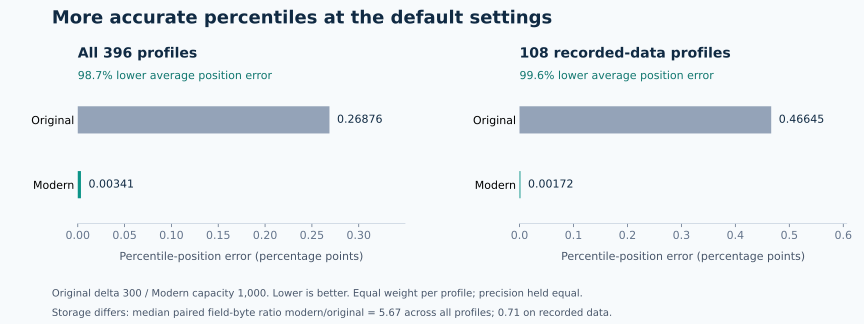

# More accurate percentiles, with measured tradeoffs

At the default settings, modern `gr_tdigest` reduced average percentile-position
error by **98.7% across 396 profiles** and **99.6% on the recorded-data subset**.
It improved both average and worst tested position error in 378 profiles, tied
in 18, and lost in none. These are substantial measured gains.



Both engines saw the same observations at the same precision. Original
`tdigest_rs` used its unchanged **delta 300** default; modern used **capacity
1,000 / K2 / singleton Use**. These controls do not mean the same number of
stored points. Defaults are a practical application comparison; comparable
storage is reported separately below.

## What the scores mean

A percentile-position error measures how far the returned answer lies from the
requested part of the sorted data. Smaller is better. Repeated values receive
their full valid position interval, so ties are not penalized artificially.

A value error measures numerical distance from a specified interpolated sample
percentile. It answers a different question. A tiny position difference across
a wide gap can mean a large value difference. The two scores should remain
separate.

## Default-setting results

The suite contains 33 data columns/distributions, both mean precisions, forward
and reverse input, and three routes: one build, 40 sequential merges and a
balanced 40-way merge. The 108 recorded-data profiles use all rows of the
[UCI bike-rental and household-energy fixtures](data/README.md). The other
profiles cover deterministic ties, gaps, tails, near-equal values and changing
shard populations. Profiles share data; they are not independent statistical
trials.

Each profile receives equal weight in these averages. Position errors below
are in **percentage points**, not relative percentages.

| Across all 396 profiles | Original | Modern | Reduction |
| --- | ---: | ---: | ---: |
| Average percentile-position error | 0.26876 | **0.00341** | **98.7%** |
| Average of each profile's worst tested position error | 1.34577 | **0.01995** | **98.5%** |
| Average median-position error | 0.26591 | **0.00426** | **98.4%** |

The largest position error anywhere on the tested grid fell from 7.39151 to
0.28076 percentage points. At the sampled tail probabilities (at or below 1%
and at or above 99%), modern had no observed rank error: 340 profiles improved
and 56 tied. This is a finite-grid observation, not an exactness guarantee for
all possible tail queries.

The recorded-data subset's average position error fell from **0.46645 to
0.00172 percentage points**. On bike-rental counts, the natural-order Float64
single-build example also reduced average numerical value error from **0.3651
to 0.0561 rentals**. Its worst numerical value error increased from 2.9994 to
4.4268 rentals; the query-level explanation below shows why these scores can
move in different directions.

All six measures remain available, including the ones where the original wins:

| Per-profile measure | Modern better | Tied | Original better |
| --- | ---: | ---: | ---: |
| Average position error | **378** | 18 | 0 |
| Worst tested position error | **378** | 18 | 0 |
| Tail position error | **340** | 56 | 0 |
| Median position error | **218** | 172 | 6 |
| Average numerical value error | **272** | 18 | 106 |
| Worst numerical value error | 168 | 30 | **198** |

Counts use the established 1e-12 score-comparison resolution. No rows are removed
because the original wins. The original has no CDF API; modern CDF is checked
against observed data, with maximum sampled error 0.27798 percentage points in
this suite. An original CDF score is not invented.

## What the storage buys

On the full default suite, the median paired ratio of modern/original logical
field bytes is **5.67**. On recorded data it is **0.71**: modern uses less field
storage in 64 of 108 profiles and more in 44. Repeated values can collapse into
exact point masses, while continuous distributions use more of modern's larger
capacity. A lower capacity is available when storage matters more.

These are observed centroid-field sizes, excluding headers, spare capacity,
allocators and process memory. Neither ratio claims the same change in RAM.
Input sample count and compressed summary size are different quantities.

The separate comparable-storage comparison uses 234 eligible established-data
profiles at modern capacity 1,000. The original parameter is selected by size,
never by accuracy, to occupy 90–100% of modern's logical field-byte budget.
All 234 eligible profiles are retained, including losses.

| At comparable logical storage | Modern better | Tied | Original better |
| --- | ---: | ---: | ---: |
| Average position error | **213** | 0 | 21 |
| Worst tested position error | **212** | 2 | 20 |
| Tail position error | **223** | 11 | 0 |
| Median position error | **121** | 100 | 13 |
| Average numerical value error | **135** | 0 | 99 |
| Worst numerical value error | 58 | 0 | **176** |

Modern's position and tail gains therefore remain visible when storage is
comparable. The remaining value-error tradeoff also remains visible. This
comparison uses the established corpus, not the additional-shape cohort, so its
counts should not be directly subtracted from the 396-profile default table.

## Why some scores move the other way

**Returning an observed point versus interpolating a sample percentile.**
We reconstructed all 204 default profiles with any loss beyond the existing
comparison resolution. In each, modern's largest value-error probe returned an
observed value at a valid percentile position: its rank error was zero. The
value reference uses straight-line interpolation between sample observations
(type 7), whereas modern retains exact point masses. Across wide gaps, these
valid conventions can produce very different values. This explains those
largest numerical value errors; it does not turn them into numerical wins.

**Local compression and merge-order tradeoffs.** Of 2,117 probes where modern's
numerical value error was larger, 1,709 had zero modern rank error and 1,999 had
modern rank error no worse than the original. The remaining 118 had a locally
worse position estimate, across 23 profiles. The largest such rank-error
increase was 0.24414 percentage points, on reversed, sequentially merged
`signed_scale` data. This is an observed local tradeoff, even though modern's
whole-profile average and worst rank errors were lower. Detailed probes and
input identities are retained; there is no blanket statement that every loss
is caused solely by the scale function.

**A small median tradeoff.** The six strict median losses include two larger
than the existing one-observation comparison resolution: the same 8,192-value
separated-cluster case under both precisions, using sequential merging. Modern
missed by two observations (0.02441 percentage points), while the original
landed at a valid median position. Modern's single-build and balanced-merge
routes have zero median-position error on that case. The source data, precision
and settings are held fixed, exposing merge order as the changing factor.

These observations support a practical accuracy assessment: strong overall
position/tail gains, with explained numerical-value and local merge tradeoffs.
An unexplained deterioration, lost mass, malformed state, invalid query or
broken exact-point behavior still requires investigation and correction.

## Reproduce and inspect

The measured runtime source is
`aaf7ab3956fed4269c1eaeef915a6faee78fa305`, Python candidate
`0.2.5.dev2026102102`. The original is pinned to
`8d9cf1fe82c5c9254e5dc9593f01717e317f4333`; its wrapper and arithmetic are
unchanged. [Raw scores, query explanations and summary](../../compat/accuracy-20261021/)
identify the exact installed native binary, data and scripts.

With that exact wheel installed and the public source/fixtures checked out:

```sh
python -I scripts/compare_default_accuracy.py \
  --source-sha aaf7ab3956fed4269c1eaeef915a6faee78fa305 \
  --expected-native-sha256 1eaaf244db7004a0b8d2aca2edc6ff027a0d3a8871c2b8c450fdf94f19701d76 \
  --output /results/fresh-default-comparison.json
python -I compat/accuracy-20261021/explain.py \
  --comparison /results/fresh-default-comparison.json \
  --output /results/fresh-query-explanations.json
```

The runner downloads nothing and refuses to overwrite previous measurements.
It uses actual compression defaults, with mean precision controlled equally;
it is not a comparison of automatic dtype inference or throughput. The data
and exact reference are shared with the existing quality suite. The optional
`plot.py` uses matplotlib to redraw the figure from the summary.

Hard correctness controls and frozen regression checks remain unchanged. Known
small-capacity diagnostic misses retain their measured scores and exit status;
none is removed to obtain this default-setting result. Explained approximation
tradeoffs do not impose a requirement to win every metric on every dataset.
